<div align="center">
  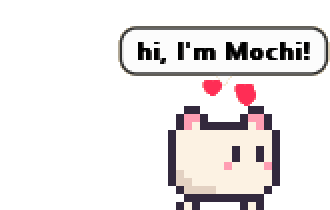
  <h1>DeskPet</h1>
  <p>A tiny pixel pet that lives on your desktop, next to the Dock on a Mac and on top of the taskbar on Windows.</p>
  <p><strong><a href="https://github.com/latiosthinh/DeskPet/releases/latest">Download for Mac</a></strong> · <strong><a href="https://github.com/latiosthinh/DeskPet/releases/latest">Download for Windows</a></strong> · <strong><a href="https://deskpet.pages.dev/pets/">Browse all pets</a></strong></p>
  <p> </p>
</div>

## See it in action

<div align="center">
  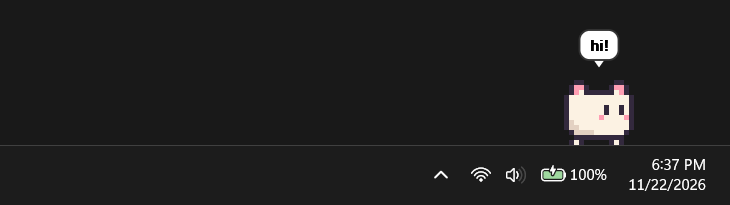
  <br>
  Mochi, on the taskbar, next to the clock. That's home.
</div>

Every pet has a pocketful of tricks. Three of them, live:

<div align="center">
  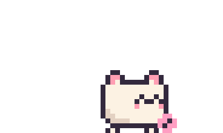
  <br>
  Mochi — Play with Yarn
</div>

<div align="center">
  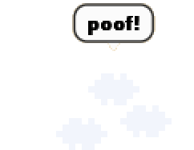
  <br>
  Kage — Smoke Bomb
</div>

<div align="center">
  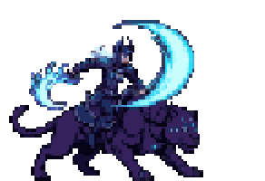
  <br>
  Moona — Throw the Glaive
</div>

## Meet the pets

Every pet is free. Mochi, Kage and Moona come with the app, one from each shelf.

The rest are one-click add-ons from the website: open **Pet → Get More Pets…**.

### Critters

<table>
<tr>
<td align="center" valign="top">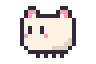<br><strong>Mochi</strong> · <em>included</em><br><sub>A sleepy little cat who naps on your taskbar, chases your cursor and sweeps up after you type.</sub></td>
<td align="center" valign="top">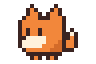<br><strong>Ember the fox</strong><br><sub>A curious fox who lights fireworks, explores with a flashlight and toasts marshmallows by the fire.</sub></td>
<td align="center" valign="top">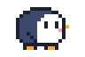<br><strong>Pip the penguin</strong><br><sub>A splashy penguin who swims, blows bubbles and hides in a puddle when you get too close.</sub></td>
<td align="center" valign="top">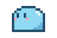<br><strong>Puddle the slime</strong><br><sub>A wobbly slime who changes colour, splits in two to play and always has a snack inside.</sub></td>
</tr>
<tr>
<td align="center" valign="top">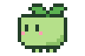<br><strong>Sprout the seedling</strong><br><sub>A tiny seedling who plants itself, grows up, chases butterflies and gives you flowers.</sub></td>
<td></td>
<td></td>
<td></td>
</tr>
</table>

### Heroes

<table>
<tr>
<td align="center" valign="top">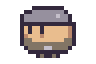<br><strong>Grumbo the warrior</strong><br><sub>A small warrior with a big helmet. Spins until dizzy and tries, really tries, to chop a log.</sub></td>
<td align="center" valign="top">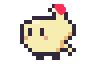<br><strong>Wisp-a-ling the spirit</strong><br><sub>A floating little spirit who reaches for your pointer and gets tied up in its own thread.</sub></td>
<td align="center" valign="top">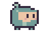<br><strong>Hexley the apprentice</strong><br><sub>An apprentice wizard whose spells mostly turn them into frogs and sheep. The book bites.</sub></td>
<td align="center" valign="top">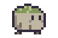<br><strong>Mossback the pebble giant</strong><br><sub>A gentle pebble giant who sprouts flowers, enjoys the rain and naps after any effort.</sub></td>
</tr>
<tr>
<td align="center" valign="top">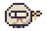<br><strong>Sir Clank</strong><br><sub>A wind-up knight who runs down, needs winding up again and never misses tea time.</sub></td>
<td align="center" valign="top">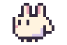<br><strong>Lunette the moon rabbit</strong><br><sub>A moon rabbit who pounds rice cakes, wishes on shooting stars and naps in a crescent moon.</sub></td>
<td align="center" valign="top">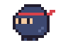<br><strong>Kage the ninja</strong> · <em>included</em><br><sub>A quiet ninja who vanishes in smoke, throws shuriken, makes clones and hides in a bush.</sub></td>
<td align="center" valign="top">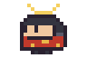<br><strong>Ronin the samurai</strong><br><sub>A calm samurai with a lightning quick draw, a proper bow and a tea ceremony between duels.</sub></td>
</tr>
</table>

### Legends

<table>
<tr>
<td align="center" valign="top">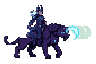<br><strong>Moona the moon knight</strong> · <em>included</em><br><sub>A moon knight riding a black panther. Throws her glaive, splits in three and calls down the moonlight.</sub></td>
<td align="center" valign="top">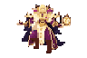<br><strong>Orbis the witcher</strong><br><sub>A sorcerer with three orbs circling overhead. Casts meteors, tornadoes, sun strikes and fire spirits.</sub></td>
<td></td>
<td></td>
</tr>
</table>

Added pets update themselves from the website once a day, and **Pet → Remove** takes one away.

## What your pet does

- 🚶 Wanders back and forth inside a small, limited area, sits, blinks, and turns to look at your pointer.
- ✨ Does one of its own tricks every 4–8 minutes (the first comes 1–3 minutes after launch), or starts one from the **Tricks** menu.
- 💻 Types along when you type (Mochi on a little laptop), and now and then has a pastime.
- 💧 Reminds you to drink water, eat lunch and dinner, and take a stretch break, and acts each one out.
- 😴 Falls asleep after 90 seconds away, and wakes up when you come back.
- 🐾 Click it to pet it (this also dismisses a reminder).
- 🏠 Drag it to move its home.

## Install

### Mac

1. Download [`DeskPet-<version>.dmg`](https://github.com/latiosthinh/DeskPet/releases/latest) from the latest release, open it, and drag **DeskPet** to **Applications**.
2. The app isn't notarized, so clear the download flag before the first launch:
   ```bash
   xattr -dr com.apple.quarantine /Applications/DeskPet.app
   ```
3. Open DeskPet.

### Windows

For Windows 10 and 11.

1. Download [`DeskPet-<version>-windows.zip`](https://github.com/latiosthinh/DeskPet/releases/latest) from the latest release and unzip it anywhere, for example into `%LOCALAPPDATA%\Programs\DeskPet`.
2. Run `DeskPet.exe`.
3. It isn't signed, so SmartScreen may warn you the first time: choose **More info → Run anyway**.

Tip: Windows 11 hides new tray icons in the overflow (**^**) — drag DeskPet's onto the taskbar.

**Update:** download the new release and run it; your pets and settings stay. **Uninstall:** delete the app (Mac: drag DeskPet to the Trash; Windows: delete the unzipped folder). Added pets live in `~/Library/Application Support/DeskPet` (Mac) or `%LOCALAPPDATA%\DeskPet` (Windows); Windows settings sit in the registry under `HKCU\Software\DeskPet`.

## Privacy and safety

No ads, no accounts, no tracking.

Pets are sandboxed WebAssembly modules: they can't touch your files, the network or the system. They only get the time and your pointer position, and say what to draw.

The only network use is keeping added pets up to date: about 20 seconds after launch, then once a day, the app asks `https://deskpet.pages.dev/api/update/<pet-id>` for each added pet. All that request carries is the pet's id in the address and the user agent "DeskPet" — no body, no cookies, nothing about you or your computer. If a newer version exists it downloads the pet file from `/download/<pet-id>`. The three built-in pets never check.

The website keeps anonymous per-pet counters (how many downloads/updates a pet got); nothing identifies you.

**Get More Pets…** opens the website in your own browser; the app itself never browses.

The whole network code is one small file, [windows/src/net.rs](windows/src/net.rs), and the sandbox lives in [shared/host/src/module.rs](shared/host/src/module.rs).

## Make your own pet

A pet is a small Rust crate of pixel art and tricks, sandboxed like the rest.

Start with [CONTRIBUTING-PETS.md](CONTRIBUTING-PETS.md).

## Support DeskPet

DeskPet is free. If it makes you smile, you can [buy the pets a coffee](https://deskpet.pages.dev/support/).

## For developers

Everything technical lives in [docs/DEVELOPMENT.md](docs/DEVELOPMENT.md): repo layout, building both apps, the pet module format, the menu reference, the website and releasing.

The pet-making guide is [CONTRIBUTING-PETS.md](CONTRIBUTING-PETS.md), and the website docs are in [website/README.md](website/README.md).

The pets and the shared pet kit are MIT-licensed — see [CONTRIBUTING-PETS.md](CONTRIBUTING-PETS.md).